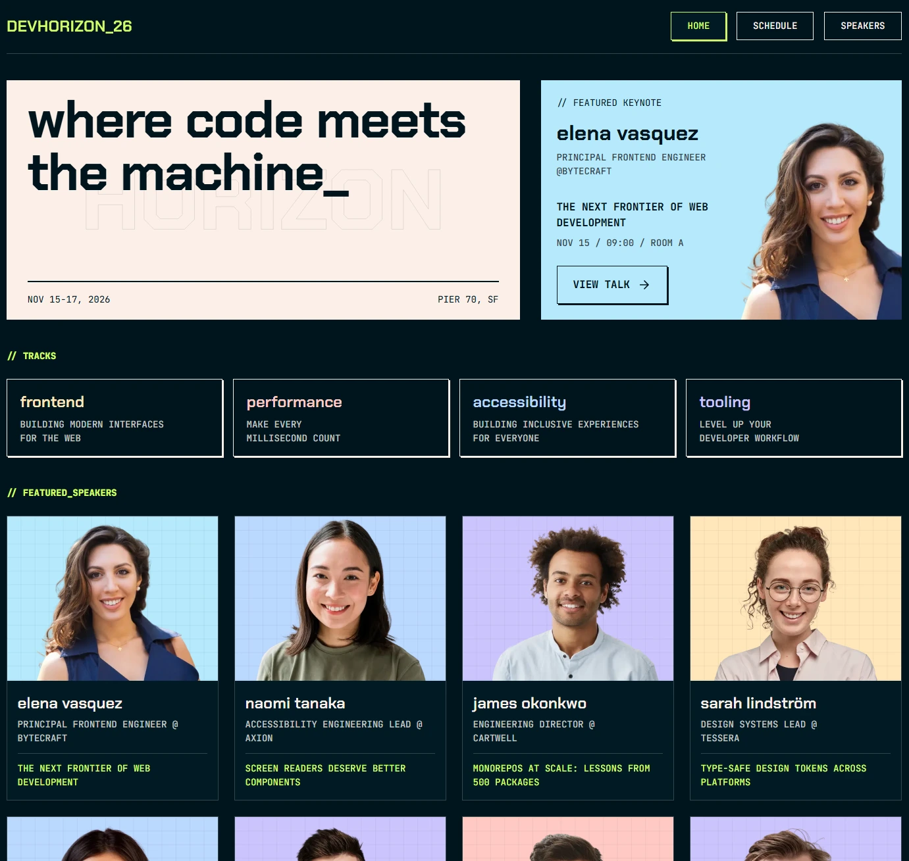
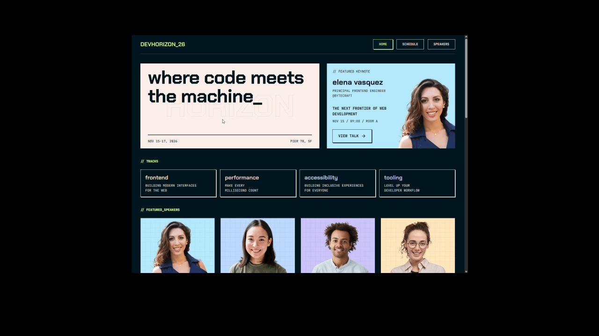
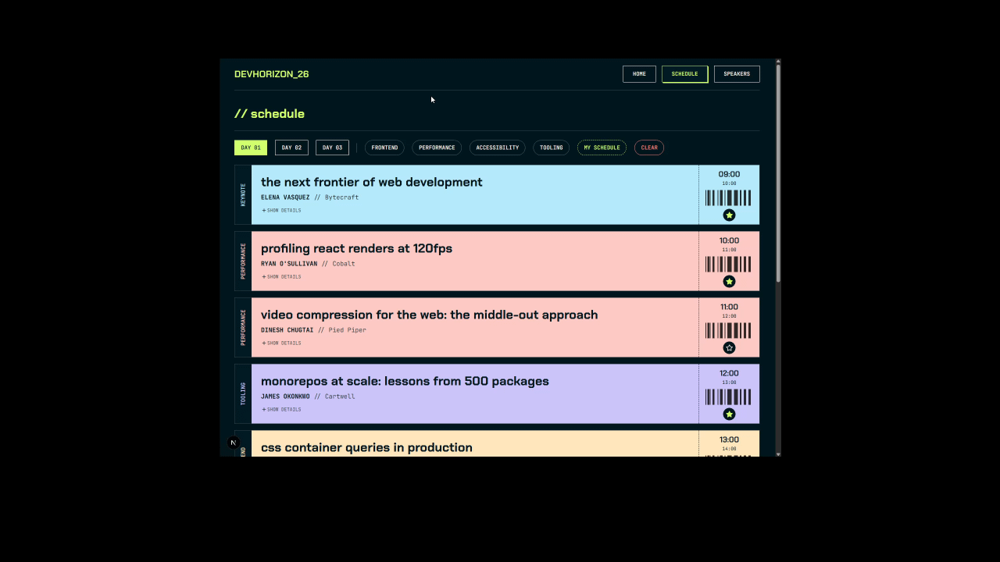
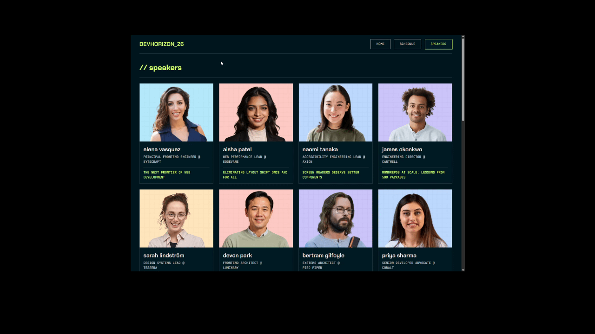
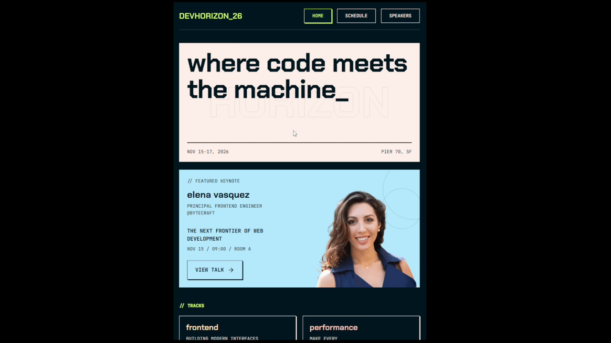
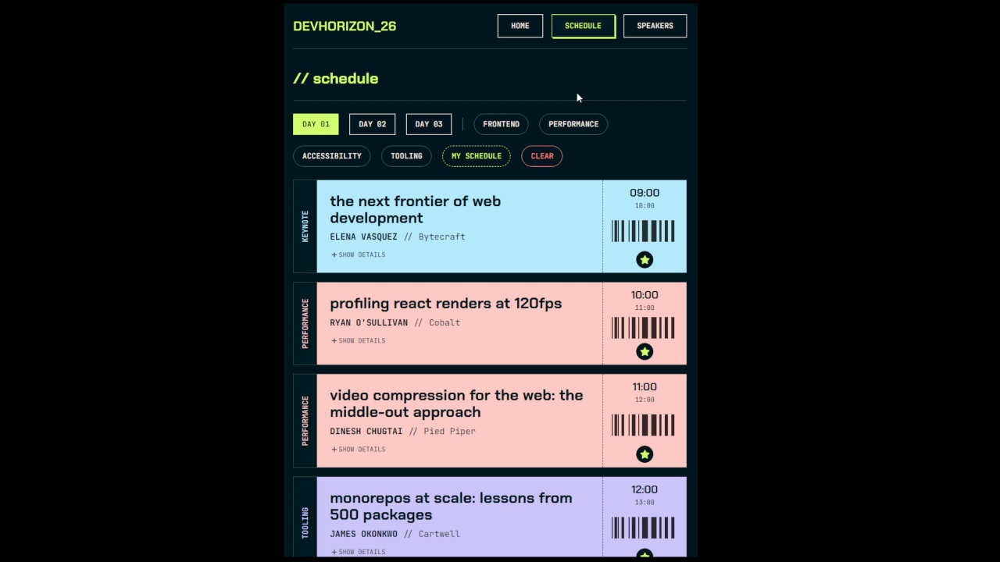
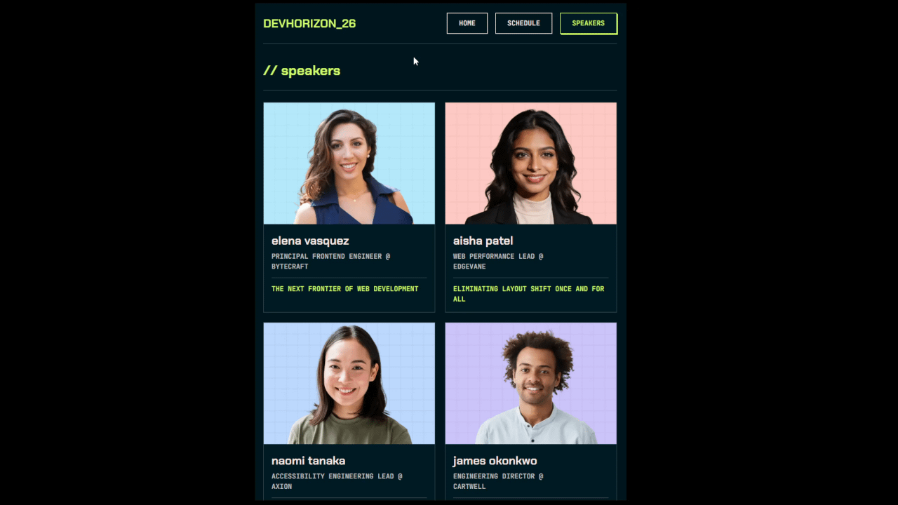
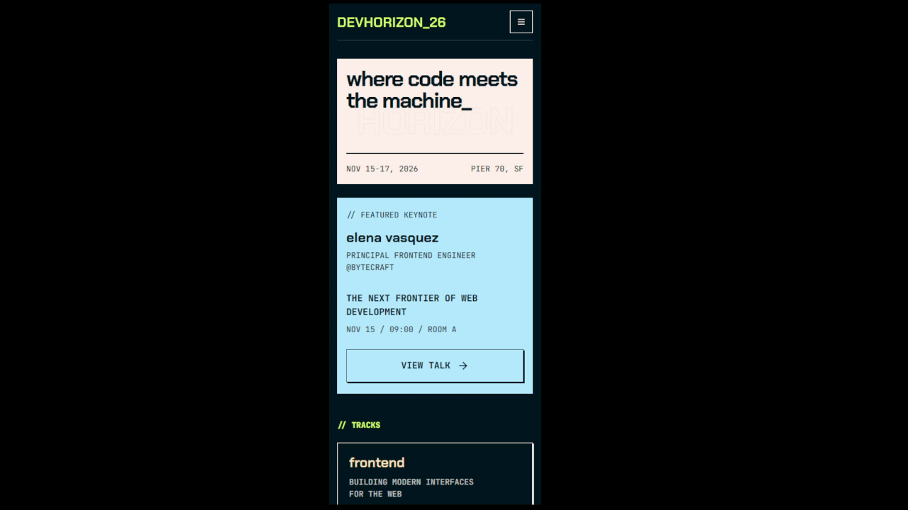
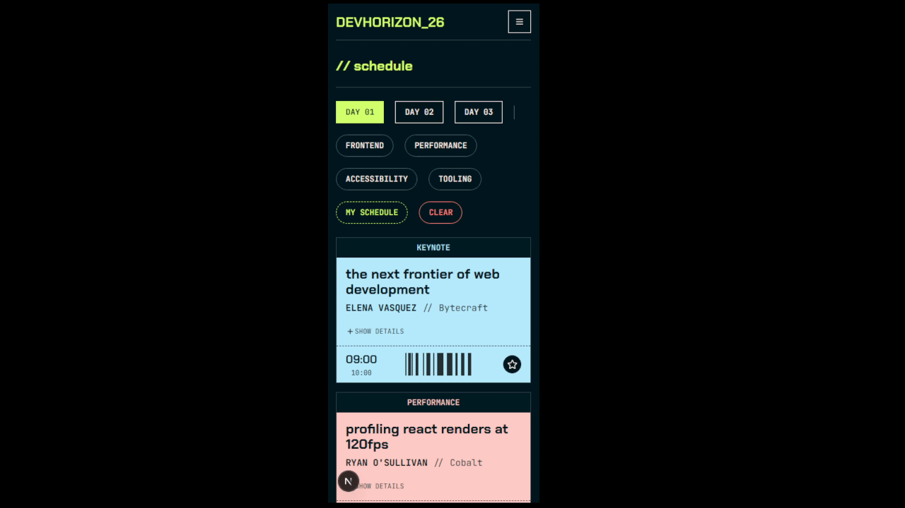
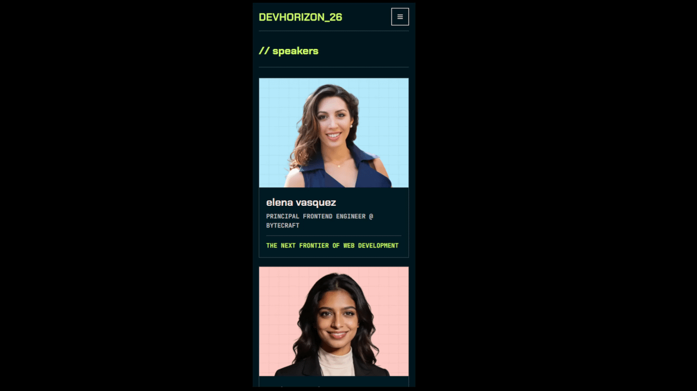

# Frontend Mentor - Tech Conference Site

A responsive conference website built as a solution to the [Tech Conference Site challenge](https://www.frontendmentor.io/challenges/tech-conference-site) on Frontend Mentor.

**[Live Demo](https://tech-conference-site-quiroz.vercel.app/)** · **[Source Code](https://github.com/Quirozdev/tech-conference-site)**



## Table of Contents

- [Getting Started](#getting-started)
  - [Prerequisites](#prerequisites)
  - [Installation](#installation)
- [Overview](#overview)
  - [Features](#features)
- [Demo](#demo)
  - [Desktop](#desktop)
  - [Tablet](#tablet)
  - [Mobile](#mobile)
- [Built With](#built-with)
- [Author](#author)

## Getting Started

### Prerequisites

- [Node.js](https://nodejs.org/)
- npm
- [Docker](https://www.docker.com/) with Docker Compose

### Installation

**1. Clone the repository**

```bash
git clone https://github.com/Quirozdev/tech-conference-site.git
cd tech-conference-site
```

**2. Install dependencies**

```bash
npm install
```

**3. Configure environment variables**

Copy `.env.example` to `.env` in the project root and provide the required values.

```bash
cp .env.example .env
```

For the local PostgreSQL setup, configure both `DATABASE_URL` and `DATABASE_URL_UNPOOLED` to connect to your local database.

**4. Start the database**

Make sure Docker is running, then start the PostgreSQL container:

```bash
docker compose up -d
```

**5. Run database migrations**

Apply the existing Prisma migrations:

```bash
npm run migration:run
```

**6. Seed the database**

Populate the database with the initial conference data:

```bash
npm run db:seed
```

**7. Start the development server**

```bash
npm run dev
```

Open [http://localhost:3000](http://localhost:3000) with your browser to see the application.

## Overview

The website provides information about a technology conference, including its schedule, tracks, speakers, and talks.

### Features

**Home**

- View the conference brand, tagline, dates, and venue.
- Discover the featured keynote and speakers.
- Browse conference tracks and schedule highlights.
- Navigate to the full schedule and speakers pages.

**Schedule**

- Browse talks organized by conference day.
- Filter talks by day and multiple tracks.
- Combine filters to narrow down the schedule.
- Expand and collapse talks to view their descriptions and locations.
- Bookmark talks to create a personal schedule.
- Filter bookmarked talks using the "My Schedule" option.
- Clear active filters.

**Speakers**

- Browse speakers in a responsive card grid.
- View speaker information, including their role, company, biography, and talk.
- Open a modal to see additional speaker and session details.
- Bookmark talks directly from the speaker modal.
- Close the modal using the close button, overlay, or Escape key.

**Responsive Design & Accessibility**

- Mobile-first layouts for desktop, tablet, and mobile devices.
- Hover and focus states for interactive elements.
- Keyboard navigation throughout the website.
- Accessible labels and interaction states.

## Demo

### Desktop

**Home**



**Schedule**



**Speakers**



### Tablet

**Home**



**Schedule**



**Speakers**



### Mobile

**Home**



**Schedule**



**Speakers**



## Built With

- [Next.js](https://nextjs.org/)
- [React](https://react.dev/)
- [TypeScript](https://www.typescriptlang.org/)
- [Prisma](https://www.prisma.io/)
- [PostgreSQL](https://www.postgresql.org/)
- [Tailwind CSS](https://tailwindcss.com/)
- [Zustand](https://zustand.docs.pmnd.rs/)
- [Docker Compose](https://docs.docker.com/compose/)

**Development Practices**

- Feature-based project organization.
- Server and Client Components.
- Server-side data fetching.
- Mobile-first development workflow.

## Author

- GitHub - [@Quirozdev](https://github.com/Quirozdev)
